# Production Plan: Smoking Detection Service (YOLO26n + EfficientNet-B0, ONNX Runtime, Docker)

**Models:** `smoking_efficientnet_b0.onnx` (classifier) + `yolo26n` (person detector).
**Runtime:** ONNX Runtime only (no PyTorch / Ultralytics in the production image). **Packaging:** Docker (+ Compose).

## Confirmed decisions

| Topic | Decision |
|---|---|
| Current goal | **A working demo**, not a camera deployment |
| Input source | **Normal video files** (upload / folder). **No cameras available.** A `FrameSource` interface keeps RTSP (the eventual CCTV case) a drop-in later |
| Alert delivery | **Web dashboard** (live annotated video, alert timeline, stats, live-tunable settings). Webhook sink kept optional |
| Hardware | **CPU only for now.** GPU image deferred |
| Classifier training data | Mendeley smoking / not-smoking photos, **fed whole** (see §0 "Training pipeline") + CCTV-style degradation. The user describes them as human crops |
| Scale | 1–2 simultaneous videos (demo); CPU budget in §1.2 |

## 0. Verified facts (checked against the actual files today)

| Item | Finding |
|---|---|
| Classifier input | `image` float32 `[batch, 3, 224, 224]`, **RGB, values 0–255** |
| Classifier normalisation | **Baked in** (`Sub(mean)/Div(std)` are the first graph ops, ImageNet mean/std ×255) → do **not** normalise in app code |
| Classifier output | `prob` float32 `[batch, 1]` = P(smoking), sigmoid already applied. Dynamic batch, opset 17 |
| Classifier metadata | ONNX has **no metadata**. [model_meta.json](file:///d:/Abdo/Task/PetroChoice/smoking_mobilenet/outputs/model_meta.json) exists in `smoking_mobilenet/outputs/` with `threshold: 0.5` (the default: no `metrics.json` was present when it was exported, so **the threshold is untuned**). Ship it with the model; tune live in the dashboard |
| Classifier preprocessing | Letterbox to 224×224, aspect preserved, **pad = 114**, no crop (same as training) |
| **Training pipeline** (read from `dataset.py`, `cctv_transforms.py`, `train.py`) | `list_samples → load_rgb (long side ≤ 640) → flip → CCTV degrade (p=0.8) → crop-free affine (p=0.7) → letterbox 224`. **There is no person-detection / crop step in the code**: the dataset photos are used whole. "Human crops" therefore holds only if the Mendeley photos are already person-centred. The production crop must be calibrated to that framing (§1.1 step 3) |
| Degradation realism | `cctv_degrade`: resize to long side 320–640, blur, motion blur, exposure/gamma/colour, IR/night, vignette, noise, barrel, interlace, timestamp overlay, JPEG q15–50. Ordinary HD video is **cleaner** than this, which is generally fine (20 % of training images were clean) |
| YOLO26n export | Default `export(format="onnx")` gives raw `(1, 84, 8400)` (needs NMS). **`end2end=True` gives `(1, 300, 6)`** = `[x1,y1,x2,y2,conf,cls]`, NMS-free. Tested with ORT 1.23.2 |
| YOLO26n classes | COCO-80, `person` = class 0. **No cigarette class** |
| Local env | Ultralytics 8.4.176, ORT 1.23.2, Intel i5-10300H (4C/8T), FastAPI available |
| **CPU latency (measured, ORT CPU EP, FP32)** | YOLO26n 640×640 batch 1: **~50 ms** (p95 ~57). EfficientNet-B0 224: **~10 ms/crop** at batch 1; batch 4 = ~60 ms, i.e. **batching gives no gain on CPU** (~15 ms/crop). Thread count 2 / 4 / 8 made little difference |

> [!IMPORTANT]
> YOLO26n (COCO) cannot see cigarettes. Its job is to **find people**. The classifier then decides
> smoking / not-smoking **per person crop**. Feeding a whole wide-scene frame to the classifier would shrink
> the cigarette to a few pixels after the 224×224 letterbox.

## 1. Pipeline

```mermaid
flowchart LR
  A["FrameSource: video file now, RTSP later"] --> B["YOLO26n ONNX<br/>letterbox 640, person only"]
  B --> C["Person boxes<br/>conf >= 0.35, min size filter"]
  C --> D["Crop + margin<br/>(person / upper-body)"]
  D --> E["Letterbox 224, pad 114"]
  E --> F["EfficientNet-B0 ONNX<br/>batched, 0-255 RGB"]
  F --> G["P(smoking) per person"]
  G --> H["Tracker + temporal vote<br/>k-of-n, cooldown"]
  H --> I["Dashboard: live overlay, alert timeline + snapshot (webhook optional)"]
```



### 1.1 Stage details

1. **Detector pre-process:** BGR→RGB, letterbox to 640×640 (pad 114), `/255`, NCHW float32.
2. **Detector post-process:** output `(1,300,6)` → keep `cls==0` and `conf >= DET_CONF` (0.35); map from letterbox
   coordinates back to the original frame (subtract pad, divide by scale, clip). **No NMS code needed**.
3. **Crop policy (`CROP_MODE`), calibrated from the training data, not guessed.** The training code has no crop recipe, so in
   Phase 1 I run YOLO26n over the training images once and measure how the person appears in them (box height / image height,
   box aspect, where the head and hands sit, margin around the box). Production crops are then chosen to land inside that
   distribution. Modes, selectable live in the dashboard:
   - `person` – person box + margin (**default**; margin value comes from the calibration).
   - `upper_body` – top ~60 % of the box; likely closest to the Mendeley framing if those photos are head/torso shots. Decide from the calibration + demo videos.
   - `full_frame` – baseline only.
   The dashboard has a **"model input" debug view** showing the exact 224×224 crops fed to the classifier, so the crop can be judged by eye.
4. **Skip rules:** drop boxes with short side < `MIN_CROP_PX` (≈ 64 px, cigarette is unresolvable) and cap at
   `MAX_PERSONS` (≈ 10, largest first).
5. **Classifier:** one call per crop (batching does not help on CPU, see §0); the session accepts dynamic batch, so a GPU image can batch later. Output `P(smoking)`.
6. **Temporal decision (essential for CCTV):** lightweight IoU tracker (no extra dependency). A track raises an
   alert when **≥ K of the last N** classified samples are ≥ threshold (default 3 of 5), then enters a
   per-camera cooldown (default 60 s). The classifier runs every `CLS_STRIDE` frames per track (default 3), not every frame.
7. **Threshold:** read from `model_meta.json` (`threshold`), overridable with env `SMOKING_THRESHOLD`.
   Fall back to 0.5 with a loud warning if missing.

> [!WARNING]
> **Crop/framing mismatch is the main accuracy risk.** The classifier never saw a detector-made crop; it saw whole photos.
> If those photos are close-ups (face + cigarette fills the frame) and the demo video shows people far away, the cigarette will be
> a few pixels and the score will be unreliable no matter the threshold. Mitigations: crop calibration (step 3), `MIN_CROP_PX`,
> an accuracy check on your own demo clips (Phase 2e). If results are poor, the fix is data-side: retrain on YOLO26n-made crops
> (same notebook, one extra preprocessing step), not model tuning.

### 1.2 CPU capacity budget (measured, not assumed)

Per processed frame ≈ detector (~50 ms) + classifier (~10 ms × crops classified). With 1–2 people ≈ 60–75 ms, so one
i5-class CPU sustains roughly **~13–16 processed frames/s in total**. For a demo with 1–2 videos:

1. **Decouple display from inference.** The browser stream runs at the video's own FPS; inference runs at `PROCESS_FPS` (default 5) and the latest boxes/scores are drawn on the in-between frames. Smooth playback, bounded CPU.
2. **`realtime` mode** keeps video time = wall time and **skips** frames if inference falls behind; **`fast` mode** analyses as quickly as the CPU allows (for generating results on long clips).
3. **Motion gate** (downscaled grey frame difference, ~1 ms): skip YOLO on static scenes.
4. **Classifier stride per track** (`CLS_STRIDE`), max 2 concurrent sessions.
5. If still short: re-export the detector at 480, or INT8 dynamic quantisation of the classifier **only after** an accuracy re-check.

## 2. Repository layout

```
PetroChoice/
├─ models/
│  ├─ smoking_efficientnet_b0.onnx
│  ├─ yolo26n.onnx                 # exported with end2end=True, imgsz=640, opset 17
│  ├─ model_meta.json              # threshold, input spec, pad value
│  └─ manifest.json                # sha256 + version of each model
├─ service/
│  ├─ app/
│  │  ├─ config.py                 # pydantic-settings, env-driven
│  │  ├─ onnx_session.py           # provider selection, warm-up, GPU fail-fast
│  │  ├─ preprocess.py             # letterbox(), crop policies
│  │  ├─ detector.py               # YOLO26n wrapper + coordinate mapping
│  │  ├─ classifier.py             # EfficientNet wrapper (batched)
│  │  ├─ tracker.py                # IoU tracker + K-of-N voting + cooldown
│  │  ├─ pipeline.py               # frame -> persons -> smoking decisions
│  │  ├─ sources.py                # FrameSource interface: VideoFileSource (now), RtspSource (later)
│  │  ├─ sessions.py               # analysis sessions: realtime/fast pacing, pause/stop, shared ORT sessions
│  │  ├─ render.py                 # overlay drawing, MJPEG JPEG encoding, optional CCTV simulation
│  │  ├─ api.py                    # FastAPI: dashboard + /api/*, /healthz, /readyz, /metrics, /version
│  │  ├─ events.py                 # alert store (SQLite/JSONL), snapshots, SSE broadcaster, optional webhook
│  │  ├─ cctv_transforms.py        # copied from training code (letterbox + cctv_degrade) for parity
│  │  └─ metrics.py                # Prometheus counters / histograms
│  ├─ dashboard/                   # static SPA: index.html, app.css, app.js (vanilla, no build step)
│  ├─ tests/                       # unit + golden + integration
│  ├─ requirements.txt             # pinned: onnxruntime(-gpu)==1.23.2, numpy, opencv-python-headless, fastapi, uvicorn, prometheus-client
│  └─ Dockerfile
├─ tools/
│  ├─ export_yolo.py               # build-time only (needs ultralytics)
│  ├─ benchmark.py                 # latency / throughput per provider
│  └─ eval_pipeline.py             # end-to-end eval on labelled clips
├─ docker-compose.yml              # CPU (default)
├─ docker-compose.gpu.yml          # GPU override
└─ .env.example
```

## 3. Model preparation (one-time, offline)

```python
# tools/export_yolo.py  (run once, outside the production image)
from ultralytics import YOLO
YOLO("yolo26n.pt").export(format="onnx", imgsz=640, opset=17, simplify=True,
                          end2end=True, dynamic=False, half=False)   # -> (1,300,6)
```

1. Copy [model_meta.json](file:///d:/Abdo/Task/PetroChoice/smoking_mobilenet/outputs/model_meta.json) next to the classifier. Its `threshold` is the untuned 0.5; if you have `metrics.json` from `evaluate.py`, re-run `export_onnx.py` to get a tuned one. Either way the dashboard slider overrides it live.
2. Generate `manifest.json` with SHA-256 for both models; the service refuses to start on a checksum mismatch.
3. Fixed 640×640 detector input (static) keeps ORT/TensorRT optimisation simple. Use `imgsz=960` only if far-field
   people are missed.
4. FP16: keep **FP32** initially. Enable FP16 later only after a parity check (see Phase 4).

## 4. Docker design

### 4.1 Images

**Now: CPU image only.** The Dockerfile keeps an `ARG VARIANT=cpu|gpu` hook so a GPU image can be added later without restructuring.

| Target | Base | ORT package | Notes |
|---|---|---|---|
| `cpu` (**build now**) | `python:3.11-slim` | `onnxruntime` | `opencv-python-headless` (its wheel bundles FFmpeg: mp4/avi/mkv/webm decode verified in Phase 6; RTSP later) |
| `gpu` (*deferred*) | `nvidia/cuda:12.x-cudnn-runtime-ubuntu22.04` (pin to ORT 1.23.x's CUDA/cuDNN matrix) | `onnxruntime-gpu` | Needs NVIDIA driver + `nvidia-container-toolkit` |

- **Multi-stage:** builder installs wheels; runtime copies the venv + `app/` + `models/` only (no compilers, no Ultralytics/torch).
- **Models baked in** to the image for immutable releases (≈ 26 MB), with `MODELS_DIR` overridable by a read-only volume for hot-swaps.
- Runs as **non-root** user, `read_only: true` root FS, writable tmpfs for `/tmp` and a volume for `/data/events`.
- `HEALTHCHECK`: `GET /healthz`; **readiness** (`/readyz`) is true only after both sessions loaded and warmed up.
- Tag format: `petrochoice-smoking:<git-sha>-<detector-ver>-<cls-ver>-<cpu|gpu>`.

### 4.2 ONNX Runtime provider handling

```python
providers = [("CUDAExecutionProvider", {"device_id": 0, "cudnn_conv_algo_search": "EXHAUSTIVE"}),
             "CPUExecutionProvider"]
sess = ort.InferenceSession(path, so, providers=providers)
if REQUIRE_GPU and "CUDAExecutionProvider" not in sess.get_providers():
    raise SystemExit("GPU requested but CUDA EP not active")   # ORT silently falls back to CPU otherwise
```

- `SessionOptions`: `graph_optimization_level=ORT_ENABLE_ALL`; CPU: `intra_op_num_threads = CPU quota`, `inter_op=1`.
- **Warm-up:** 3 dummy inferences per model at startup (cuDNN autotune, memory arena).
- One session per model, shared across workers; use **IO binding** on GPU in Phase 4 if profiling shows copy overhead.
- Optional later: TensorRT EP (`TensorrtExecutionProvider` with engine cache volume) – only after the CUDA EP baseline is measured.

### 4.3 Compose (CPU now; GPU override is a later add-on)

```yaml
# docker-compose.yml (CPU)           # docker-compose.gpu.yml (override)
services:                            services:
  smoking:                             smoking:
    build: {context: ., args: {VARIANT: cpu}}   build: {args: {VARIANT: gpu}}
    env_file: .env                     deploy:
    ports: ["8080:8080"]                 resources:
    volumes: ["events:/data/events"]       reservations:
    restart: unless-stopped                  devices: [{driver: nvidia, count: 1, capabilities: [gpu]}]
    read_only: true
    tmpfs: ["/tmp"]
```

Run: `docker compose up -d` (CPU). Set `cpus:` / `ORT_THREADS` to the CPU you want to dedicate (ORT otherwise uses all cores).
Later (GPU): `docker compose -f docker-compose.yml -f docker-compose.gpu.yml up -d`.

### 4.4 Configuration (env vars)

| Var | Default | Purpose |
|---|---|---|
| `REQUIRE_GPU` | `0` | Fail fast if CUDA EP not active (GPU image only, later) |
| `ORT_THREADS` | `4` | ORT intra-op threads per session (leaves CPU for video decode + MJPEG encode) |
| `PROCESS_FPS` | `5` | Frames analysed per second of video (tunable live) |
| `MAX_SESSIONS` | `2` | Concurrent analysis sessions |
| `VIDEOS_DIR` | `/data/videos` | Folder of demo videos listed in the dashboard (read-only mount) |
| `UPLOAD_DIR` / `MAX_UPLOAD_MB` | `/data/uploads` / `500` | Uploaded videos (mp4, avi, mov, mkv, webm; validated on upload) |
| `CCTV_SIM` | `0` | Optionally degrade frames with `cctv_degrade` to preview the CCTV look |
| `DASH_TOKEN` | *(empty)* | Optional bearer token; compose binds to `127.0.0.1` by default |
| `MOTION_GATE` | `1` | Skip detector on static frames |
| `DET_CONF` | `0.35` | Person detection confidence |
| `CROP_MODE` | `person` | `person` (matches training) / `upper_body` / `full_frame` |
| `MIN_CROP_PX` | `64` | Skip tiny people |
| `MAX_PERSONS` | `10` | Per-frame cap |
| `SMOKING_THRESHOLD` | from `model_meta.json` | Classifier decision threshold |
| `VOTE_K` / `VOTE_N` | `3` / `5` | Temporal voting |
| `CLS_STRIDE` | `3` | Classify every Nth frame per track |
| `COOLDOWN_S` | `60` | Alert dedup per source (video / camera) |
| `EVENT_SINK` | `dashboard` | `dashboard` (+ optional `webhook`) |
| `SNAPSHOT_RETENTION_DAYS` | `7` | Alert-snapshot retention |

## 5. Service interface & dashboard

### 5.1 Sources and sessions

- `FrameSource` yields `(frame, video_time_s)`; `VideoFileSource` (OpenCV/FFmpeg, EXIF/rotation aware, validates codec on upload). `RtspSource` is a later drop-in (reconnect + latest-frame-wins) with no pipeline change.
- A **session** = one source + the shared detector/classifier sessions + a tracker. Pacing: `realtime` (skip frames to stay in sync) or `fast`. Controls: pause / resume / seek-restart / stop; loop option.
- Events are stored with `video_time`, `track_id`, `bbox`, `p_smoking`, snapshot path (alerts only, retention-limited).

### 5.2 API

| Endpoint | Purpose |
|---|---|
| `GET /` | Dashboard SPA |
| `GET /api/videos` · `POST /api/videos` | List folder + uploaded videos · upload (size/type limit, validated) |
| `POST /api/sessions` `{video_id, mode, loop}` | Start analysis; `GET /api/sessions` lists them; `POST /api/sessions/{id}/pause\|resume\|stop` |
| `GET /api/sessions/{id}/stream` | **MJPEG** annotated video (works in a plain ``) |
| `GET /api/sessions/{id}/crops` | MJPEG/JSON of the exact 224×224 classifier inputs (debug view) |
| `PATCH /api/config` | Live-tune `threshold`, `VOTE_K/N`, `crop_mode`, `process_fps`, `det_conf`, `cctv_sim` |
| `GET /api/events` · `GET /api/events/stream` (**SSE**) | Alert history (filter/export JSON·CSV) · live push to the dashboard |
| `GET /api/snapshots/{id}.jpg` | Alert snapshot |
| `POST /v1/predict` (multipart image) | Single-image debug: persons, `p_smoking` per person |
| `GET /healthz` · `/readyz` · `/metrics` · `/version` | Liveness · models warmed up · Prometheus · image tag, model SHA-256s, threshold, crop mode |

### 5.3 Dashboard (vanilla HTML/CSS/JS, dark glass UI, no Node/build step)

| Panel | Content |
|---|---|
| Source bar | Pick folder/uploaded video or drag-and-drop upload; start / pause / stop; `realtime` ↔ `fast`; loop |
| **Live view** | Annotated MJPEG: person boxes colour-coded (green = not smoking, amber = voting in progress, red = smoking alert), track id, live `P(smoking)`; "ALERT" banner flash |
| KPI cards | Processing FPS, detector / classifier latency (p50/p95), persons in frame, alerts this session, dropped frames, CPU provider |
| Alert timeline | Cards with snapshot thumbnail, video timestamp, track, peak probability; click → enlarged snapshot; export JSON/CSV |
| Probability chart | Per-track sparkline of `P(smoking)` against the threshold line (shows why voting fired / did not fire) |
| **Tuning drawer** | Threshold slider, K-of-N, crop mode, process FPS, person-conf, CCTV-simulation toggle, **"model input" crops view** |
| Status footer | Model versions/SHA, threshold source (`model_meta.json` = untuned 0.5), version |

Security for the demo: bind to localhost by default, optional `DASH_TOKEN`, upload size/extension/codec checks, files stored under a fixed directory with generated names (no user paths).

## 6. Implementation phases & verification gates

| # | Phase | Deliverable | Verification (gate) |
|---|---|---|---|
| 1 | **Model assets + crop calibration** | `yolo26n.onnx` (end2end), `model_meta.json`, `manifest.json`, `crop_calibration.json` | Shapes match §0; checksum check works; calibration report: distribution of person-box size/aspect/margin over the training images (needs the Mendeley zip, auto-downloadable via `download_data.py`) |
| 2 | **Core pipeline (library, no Docker)** | `preprocess`, `detector`, `classifier`, `pipeline`, tests | (a) Detector parity vs `ultralytics predict` on 20 images: IoU > 0.95, same count. (b) Classifier parity vs training-code probabilities: max diff < 1e-4. (c) Letterbox inverse-mapping unit test. **(d) Crop check:** pipeline crops on training images visually match the calibration (contact sheet reviewed by you). **(e) Demo-clip check:** 5–10 of your clips (smoking / not) labelled by timestamp; report per-clip alert hit/miss and false alerts for each `CROP_MODE`; pick the default |
| 3 | **Temporal logic** | `tracker`, K-of-N voting, cooldown, motion gate | Synthetic tests: flicker suppressed, cooldown honoured, static scene skips detector, track id stable across short occlusions |
| 4 | **Sources, sessions, API** | `sources.py`, `sessions.py`, `render.py`, `events.py`, `api.py` | Upload → start session → MJPEG plays in a browser; realtime stays in sync (drift < 1 s over a 5-min clip); pause/stop leak no threads; SSE delivers an alert within 1 s of voting |
| 5 | **Dashboard UI** | `dashboard/` (SPA) | Manual walkthrough on a real video: every panel in §5.3 works; layout checked at laptop + wide widths; no console errors; live tuning visibly changes decisions |
| 6 | **Docker (CPU)** | Dockerfile (CPU target, GPU hook), `docker-compose.yml`, `.env.example` | `docker compose up` → `/readyz` 200; same outputs as local (diff < 1e-4); video decode works in-container; non-root + read-only FS; volumes for videos/uploads/events; image size reported |
| 7 | **CPU performance + demo rehearsal** | `benchmark.py` report | End-to-end FPS for 1 and 2 sessions under the container CPU limit; confirm §1.2; tune `PROCESS_FPS`, `ORT_THREADS`; run the full demo script twice from a clean `docker compose up` |
| 8 | **Later: production on CCTV** | `RtspSource`, reconnect, ROI masks, webhook/MQTT sink, CI, runbook | 24 h RTSP soak (no memory growth, reconnect after cable pull); real CCTV clips for the accuracy gate; shadow mode before alerting |

## 7. Testing strategy

- **Unit:** letterbox and its inverse, YOLO output decode, crop policies, tracker association, K-of-N + cooldown.
- **Golden:** fixed images with stored expected detections and `P(smoking)`; fails CI on drift (guards against export / ORT upgrades).
- **Integration:** compose up → HTTP predict → assert JSON schema and metrics increment.
- **Soak / load:** loop a 10-minute video for 1 h; watch RAM, latency, dropped frames. (Later, for production: `ffmpeg -re` → local RTSP replay.)
- **Shadow mode first:** run in production **log-only** for 1–2 weeks, review alerts with the station, then tune `threshold`, `VOTE_K/N`, `CROP_MODE` before enabling real notifications.

## 8. Operations & compliance

- Structured JSON logs (camera, track, probability; **no raw frames in logs**).
- Snapshots saved **only for alerts**, with retention + size cap. Check local privacy / CCTV regulations; consider face blur on stored snapshots.
- Rollback = redeploy previous image tag (models are baked into it). Model changes = new image tag + new manifest.
- Monitoring alerts: no frames processed for N min, camera offline, p95 latency high, GPU EP lost.
- Safety note: a fuel-station smoking alert is advisory; keep a human in the loop for any automatic action.

## 9. Risks & mitigations

| Risk | Mitigation |
|---|---|
| Classifier trained on whole photos; production feeds detector crops (framing mismatch) | Crop calibration on the training set (Phase 1); "model input" debug view; per-clip check on your videos (Phase 2e); retrain on YOLO crops if needed |
| Synthetic CCTV degradation ≠ real cameras | Phase 2e gate on real footage; shadow mode; collect hard cases for retraining |
| CPU saturates with several sessions or cameras | §1.2 levers: `PROCESS_FPS`, motion gate, stride, `MAX_SESSIONS`; measured budget ~13–16 frames/s |
| Cigarette too small at CCTV distance | `upper_body` crop, `MIN_CROP_PX`, optional `imgsz=960`, 256-px classifier retrain |
| False alarms (phone to ear, drinking, vaping) | Temporal K-of-N voting, tuned threshold, shadow-mode review, collect hard negatives for retraining |
| Silent CPU fallback in the GPU image | `REQUIRE_GPU` fail-fast + `/readyz` + provider metric |
| YOLO export mismatch (raw vs end2end) | Manifest pins output shape; startup assertion `(1,300,6)`; golden test |
| Browser lag / CPU overload from rendering | Display decoupled from inference, JPEG quality + max width 960, frame skipping in `realtime`, `MAX_SESSIONS=2` |
| Demo video has no CCTV look / different resolution than training | `CCTV_SIM` toggle to preview; letterbox + crop calibration handle resolution; 20 % clean training images |
| Stale/laggy RTSP frames (later, production) | Latest-frame-wins queue, bounded queues, dropped-frame metric |
| Threshold lost / wrong | Shipped in `model_meta.json`, logged on startup, exposed at `/version` |
| ORT / CUDA version drift | Pinned versions + CUDA matrix tag + CI golden tests |

## 10. Still needed from you (defaults used until provided)

1. **Were the training images person crops made by another tool?** The code in the workspace uses the Mendeley photos whole. If you made crops separately (script/notebook), send it; otherwise I calibrate from the data (Phase 1). *Default: calibration.*
2. **A few demo videos** (smoking / not smoking, ideally people filmed at the distance you will show) for Phase 2e and for picking the default `CROP_MODE`. *Without them I can only test on synthetic/downloaded clips.*
3. **Dashboard language/branding** (English only? logo/name "PetroChoice"?). *Default: English, "PetroChoice" title.*
4. **Where will the demo run** (this Windows laptop with Docker Desktop, or another machine)? *Default: this laptop; compose binds to localhost.*
