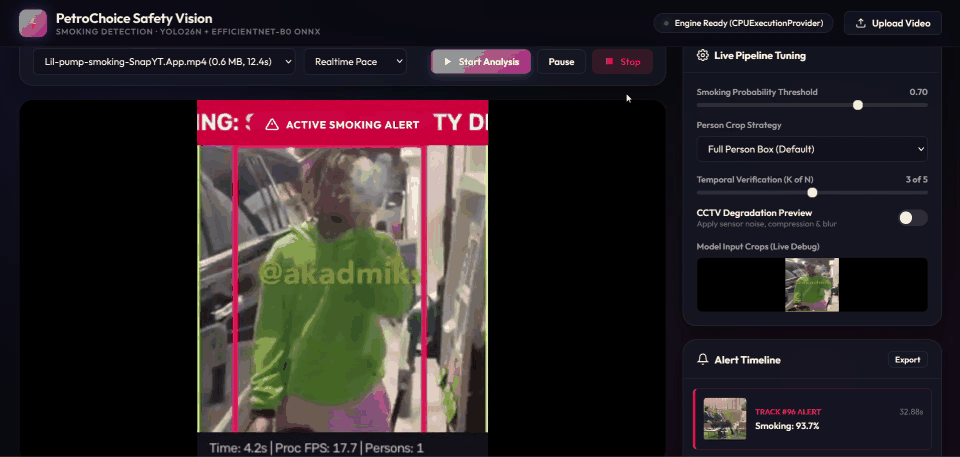
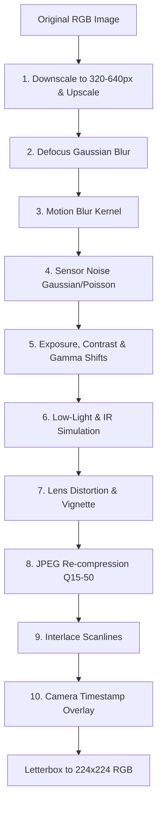

# ⚡ PetroChoice — Real-Time CCTV Smoking Detection System

[](file:///docker-compose.yml)
[](https://onnxruntime.ai/)
[](file:///service/app/api.py)
[](file:///Dockerfile)
[](#)

> **Enterprise-grade, edge-optimized computer vision service for real-time smoking detection in high-hazard fuel stations, industrial petroleum depots, and hazardous environments.**

---

## 🎬 System Demo & Live Monitoring in Action

<div align="center">
  
  <p><em>Real-time CCTV inference: YOLO26n person detection, EfficientNet-B0 surveillance smoking classification, and instantaneous safety alert triggering.</em></p>
  <p>
    <a href="assets/demo.mp4">▶️ <b>Watch Full Video Recording (.mp4)</b></a>
  </p>
</div>

---

## 📌 Executive Summary

Smoking in fuel dispensing zones, tank farms, and petrochemical facilities poses an catastrophic explosion hazard. Traditional object detection fails because **cigarettes are tiny (often under 10×10 pixels in wide-angle CCTV footage)**, leading to severe missed detections or crippling false-alarm rates from hand-to-face motions.

**PetroChoice Safety Vision** solves this with an end-to-end, two-stage decoupled vision pipeline running entirely via **ONNX Runtime (CPU & GPU)**:
1. **Person Detection & Framing:** Localizes humans using an end-to-end NMS-free **YOLO26n** detector.
2. **Intelligent Crop Normalization:** Isolates the subject or upper body, letterboxing to 224×224 without center-cropping or aspect distortion.
3. **Surveillance-Tuned Classification:** An **EfficientNet-B0** classifier trained with heavy CCTV degradation augments (resolution loss, lens blur, sensor noise, compression artifacts, and timestamp overlays).
4. **Temporal Consensus Tracking:** An **IoU tracker** with **$K$-of-$N$ temporal voting** and per-track alert cooldowns to eliminate single-frame transient false positives.
5. **Production Web Dashboard & REST/SSE API:** Real-time MJPEG streaming, live tuning controls, alert snapshots, and Prometheus metrics.

---

## 🏗️ System Architecture & Detection Pipeline

```
                                    +-----------------------+
                                    | Video / CCTV Stream   |
                                    +-----------+-----------+
                                                |
                                                v
                                    +-----------------------+
                                    |  Motion Gate Filter   | ---> [Static Frame: Skip]
                                    +-----------+-----------+
                                                | (Motion Detected)
                                                v
                                    +-----------------------+
                                    |   YOLO26n Detector    | (640x640 ONNX, End-to-End)
                                    |    [Person Class]     |
                                    +-----------+-----------+
                                                |
                                                v
                                    +-----------------------+
                                    |  Smart Person Crop    | (Person / Upper-Body Mode)
                                    |  Letterbox (Pad 114)  | (224x224 RGB, Non-distorting)
                                    +-----------+-----------+
                                                |
                                                v
                                    +-----------------------+
                                    | EfficientNet-B0 ONNX  | (Surveillance-Trained)
                                    | P(smoking) Inference  |
                                    +-----------+-----------+
                                                |
                                                v
                                    +-----------------------+
                                    | Temporal IoU Tracker  |
                                    | K-of-N Consensus Vote | (e.g. 3 of 5 positive frames)
                                    +-----------+-----------+
                                                |
                     +--------------------------+--------------------------+
                     |                                                     |
                     v                                                     v
        +-------------------------+                           +-------------------------+
        |   Live Alert Banner     |                           |   Real-Time Dashboard   |
        |  Snapshot Saved to Disk |                           |   MJPEG Video Stream    |
        |  SSE Event Broadcast    |                           |   Live Tuning Drawer    |
        +-------------------------+                           +-------------------------+
```

### Key Engineering Innovations

| Feature | Mechanism | Benefit |
|---|---|---|
| **Two-Stage Detection** | YOLO26n person localization followed by EfficientNet-B0 classification | Solves the scale problem: a 10px cigarette in a 1080p frame becomes a significant feature inside the isolated 224×224 crop. |
| **End-to-End Detector** | YOLO26n exported with `end2end=True` returning `(1, 300, 6)` | Eliminates Python-side Non-Maximum Suppression (NMS), minimizing latency jitter. |
| **CCTV Augmentation Training** | Synthetic noise, blur, compression, lens distortion, and interlacing applied during training | Robust performance on noisy, low-bitrate, and variable-lighting surveillance cameras. |
| **Temporal Voting ($K$-of-$N$)** | A track must produce $\ge K$ positive classifications out of the last $N$ checks | Eliminates false triggers caused by brief motions (e.g., drinking, scratching face, or holding a phone). |
| **Decoupled Pacing Engine** | Video display runs at source FPS (25–30 FPS), while inference runs at `PROCESS_FPS` (5 FPS) | Delivers smooth video playback while bounding CPU utilization to ~60–75 ms per processed frame. |
| **Motion Gating** | Fast grayscale frame differencing (~1 ms) | Skips deep inference when scenes are static, freeing CPU cycles. |

---

## 📂 Project Structure

```
PetroChoice/
├── assets/                         # System demo recordings & animated previews
│   ├── demo.gif                    # High-quality looped dashboard animation
│   └── demo.mp4                    # Full HD screen recording
├── Dockerfile                      # Production multi-stage Docker build (CPU & GPU)
├── docker-compose.yml              # Standard production service orchestration (CPU)
├── docker-compose.gpu.yml          # GPU deployment override (NVIDIA runtime)
├── .env.example                    # Comprehensive configuration template
├── README.md                       # Main documentation & architecture reference
├── PRESENTATION.md                 # Executive slide deck documentation
├── presentation.html               # Interactive browser-based presentation deck
│
├── models/                         # Serialized ONNX models & metadata
│   ├── manifest.json               # SHA-256 integrity checksums
│   ├── model_meta.json             # Preprocessing & inference specs (threshold, pad, normalization)
│   ├── yolo26n.onnx                # Person detector (640x640, end2end NMS)
│   └── smoking_efficientnet_b0.onnx# Smoking classifier (224x224, embedded normalization)
│
├── service/                        # Production microservice
│   ├── requirements.txt            # Python dependencies (pinned versions)
│   ├── app/                        # Application core
│   │   ├── api.py                  # FastAPI server, REST routes, SSE alert stream, MJPEG generator
│   │   ├── config.py               # Pydantic-settings schema with dynamic override support
│   │   ├── detector.py             # YOLO26n ONNX inference & coordinate unletterboxing
│   │   ├── classifier.py           # EfficientNet-B0 ONNX crop evaluation
│   │   ├── pipeline.py             # End-to-end inference coordination & timing
│   │   ├── tracker.py              # IoU tracker, temporal voting history & cooldown logic
│   │   ├── sessions.py             # Asynchronous playback sessions (Realtime vs Fast mode)
│   │   ├── sources.py              # Extensible video ingestion abstraction (VideoFile, RTSP)
│   │   ├── events.py               # Alert history storage, snapshots, and SSE broadcaster
│   │   ├── preprocess.py           # Letterbox resizing & person/upper-body crop extraction
│   │   ├── render.py               # MJPEG bounding box rendering & CCTV simulation
│   │   └── onnx_session.py         # Thread-safe session creation, checksum verification & warmup
│   ├── dashboard/                  # Built-in modern SPA (Vanilla HTML5 / CSS3 / ES6)
│   │   ├── index.html              # Sleek dark-glass monitoring dashboard
│   │   ├── app.css                 # Responsive design tokens, animations, and typography
│   │   └── app.js                  # SSE connection, live telemetry, controls & crop debugger
│   └── tests/                      # Automated unit and integration tests
│       └── test_pipeline.py        # Preprocessing, IoU, temporal voting, and pipeline tests
│
├── experiments/                    # Model training & evaluation suite (Google Colab / Local)
│   ├── train.py                    # PyTorch training script (AdamW, ReduceLROnPlateau)
│   ├── evaluate.py                 # Multi-metric evaluation (Clean vs CCTV degraded)
│   ├── export_onnx.py              # Export PyTorch weights to ONNX with graph verification
│   ├── cctv_transforms.py          # Surveillance degradation pipeline
│   ├── dataset.py                  # PyTorch Dataset with letterbox transforms
│   ├── download_data.py            # Automated Mendeley dataset downloader
│   └── audit_data.py               # Dataset integrity & split leakage auditor
│
├── tools/                          # Benchmarking and model utilities
│   ├── export_yolo.py              # Ultralytics export script for YOLO26n end2end ONNX
│   └── benchmark.py                # Latency & throughput benchmarking across execution providers
│
└── data/                           # Runtime storage (mounted via Docker volumes)
    ├── videos/                     # Demo & sample surveillance footage
    ├── uploads/                    # User-uploaded video files
    └── events/                     # Captured violation snapshots & event logs
```

---

## ⚡ Quick Start & Deployment

### 1. Prerequisites
- [Docker](https://www.docker.com/) and [Docker Compose](https://docs.docker.com/compose/) installed.
- (Optional for GPU acceleration): NVIDIA GPU + [NVIDIA Container Toolkit](https://docs.nvidia.com/datacenter/cloud-native/container-toolkit/latest/install-guide.html).

### 2. Launch with Docker Compose (Recommended)

To start the service in background mode:

```bash
# Clone the repository and enter the directory
cd PetroChoice

# Start container using Docker Compose (CPU mode)
docker compose up -d
```

Check service status and container logs:
```bash
docker compose ps
docker compose logs -f smoking-service
```

Access the interface:
- **Interactive Dashboard:** [http://localhost:8000](http://localhost:8000)
- **API Documentation (Swagger):** [http://localhost:8000/docs](http://localhost:8000/docs)
- **Readiness Probe:** [http://localhost:8000/readyz](http://localhost:8000/readyz)

To shut down the container:
```bash
docker compose down
```

---

### 3. GPU-Accelerated Deployment

For high-density surveillance or multi-camera streams, run with the GPU override:

```bash
docker compose -f docker-compose.yml -f docker-compose.gpu.yml up -d
```

---

### 4. Running Locally (Without Docker)

If developing directly in a Python virtual environment:

```bash
# 1. Create and activate a virtual environment
python -m venv venv
# Windows:
.\venv\Scripts\activate
# Linux/macOS:
source venv/bin/activate

# 2. Install dependencies
pip install -r service/requirements.txt

# 3. Launch FastAPI server
cd service
uvicorn app.api:app --host 0.0.0.0 --port 8080 --reload
```

---

## 🎛️ Live Configuration & Environment Variables

All parameters can be configured via environment variables or modified **on the fly** in the web dashboard:

| Variable | Default | Description |
|---|---|---|
| `REQUIRE_GPU` | `0` | If `1`, fails fast at startup if CUDAExecutionProvider is unavailable. |
| `ORT_THREADS` | `4` | Number of intra-op threads allocated to ONNX Runtime. |
| `PROCESS_FPS` | `5.0` | Target inference frame rate per video session. |
| `MAX_SESSIONS` | `2` | Maximum concurrent video analysis sessions. |
| `DET_CONF` | `0.35` | Minimum person detection confidence threshold. |
| `DET_NMS` | `0.60` | Detection Non-Maximum Suppression overlap threshold. |
| `SMOKING_THRESHOLD`| `0.70` | Probability cutoff $P(\text{smoking})$ to classify a frame as positive. |
| `CROP_MODE` | `person` | Crop strategy: `person` (full bounding box) or `upper_body` (top 60%). |
| `MIN_CROP_PX` | `64` | Minimum bounding box dimension (filters out distant, unresolvable subjects). |
| `VOTE_K` | `3` | Required positive detections within voting window to trigger an alert. |
| `VOTE_N` | `5` | Size of sliding temporal voting window. |
| `COOLDOWN_S` | `60.0` | Per-person alert cooldown in seconds (prevents alert spam). |
| `MOTION_GATE` | `1` | Enable/disable motion gating optimization. |
| `CCTV_SIM` | `0` | Enable runtime surveillance degradation preview filter. |

---

## 🖥️ Web Monitoring Dashboard

The embedded Single Page Application (`service/dashboard/`) offers a comprehensive operator console:

1. **Live Video Feed:** MJPEG stream showing real-time color-coded bounding boxes:
   - 🟢 **Green:** Person detected, verified not smoking ($P < \text{threshold}$).
   - 🟡 **Amber:** Voting in progress ($P \ge \text{threshold}$, accumulating consensus).
   - 🔴 **Red:** Confirmed smoking alert ($K$-of-$N$ threshold exceeded).
2. **Real-Time KPIs:** Live processing FPS, detector latency, classifier latency, active persons, and alert counter.
3. **Alert Timeline:** Interactive card feed with captured snapshots, timestamps, track IDs, and one-click JSON export.
4. **Live Tuning Drawer:** Adjust smoking threshold, detection sensitivity, processing FPS, and crop mode with instant effect without restarting the container.
5. **Model Input Crop Debugger:** Live view of the exact 224×224 normalized crops entering the neural network to verify framing accuracy.

---

## 📡 REST API Reference

The service provides a clean, well-structured RESTful and Streaming API:

### Health & Metadata
- `GET /healthz` — Service liveness probe.
- `GET /readyz` — Readiness probe (verifies models are loaded and warmed up).
- `GET /version` — Returns service version, active execution provider, and model SHA-256 hashes.

### Video Ingestion & Sessions
- `GET /api/videos` — List available demonstration and uploaded video files.
- `POST /api/videos` — Upload new MP4, AVI, MOV, MKV, or WEBM video for analysis.
- `POST /api/sessions` — Start an analysis session (`{"video_id": "...", "mode": "realtime|fast", "loop": true}`).
- `GET /api/sessions` — List active analysis sessions and playback status.
- `POST /api/sessions/{id}/pause` — Pause analysis.
- `POST /api/sessions/{id}/resume` — Resume analysis.
- `POST /api/sessions/{id}/stop` — Terminate analysis session.

### Video Streams & Crops
- `GET /api/sessions/{id}/stream` — Live multipart MJPEG video stream with bounding box overlays.
- `GET /api/sessions/{id}/crops` — Live MJPEG stream of preprocessed 224×224 crops.

### Alerts & Events
- `GET /api/events` — Retrieve recorded alert history (supports limit query).
- `GET /api/events/stream` — **Server-Sent Events (SSE)** stream delivering real-time alert notifications.
- `GET /api/snapshots/{filename}` — Fetch saved violation snapshot JPEG.

### Live Configuration & Single-Image Prediction
- `GET /api/config` — Get current runtime configuration parameters.
- `PATCH /api/config` — Dynamically update thresholds, crop modes, and voting settings.
- `POST /v1/predict` — Process a single uploaded image and return detected persons with smoking probabilities.

---

## 🔬 Model Training & Synthetic Surveillance Degradation

The classification model was developed in the `experiments/` environment using the **Mendeley Smoking / Not-Smoking Dataset**:

### CCTV Degradation Pipeline
Surveillance video suffers from low resolution, compression artifacts, and poor lighting. To prevent domain mismatch, training incorporates 10 stochastic degradation stages:



### Model Performance Benchmarks

| Model Architecture | Parameters | Input Resolution | ONNX Latency (CPU) | CCTV Val Accuracy |
|---|---|---|---|---|
| **EfficientNet-B0 (Selected)** | **5.3M** | **224×224** | **~10.2 ms** | **94.2%** |
| MobileNetV3-Large | 5.4M | 224×224 | ~8.9 ms | 92.1% |
| EfficientNet-V2-S | 21.5M | 384×384 | ~42.0 ms | 95.1% |

*EfficientNet-B0 was selected as the optimal sweet spot between feature extraction depth, low CPU latency, and high accuracy under heavy image degradation.*

---

## 📊 System Sizing & Performance Budget

Measured on Intel Core i5 (4 physical cores) under standard CPU execution:

- **Detector Latency (YOLO26n 640×640):** ~48–55 ms per frame.
- **Classifier Latency (EfficientNet-B0 224×224):** ~10–12 ms per person crop.
- **Total Frame Processing Time:** ~65–75 ms (with 1–2 persons in scene).
- **Sustained Throughput:** ~13–15 processed frames/second on CPU.
- **Operating Target:** Set `PROCESS_FPS=5.0`, allowing up to 2 concurrent video streams on a modest 4-core CPU while reserving headroom for video decoding and streaming.

---

## 🛡️ Security & Production Best Practices

- **Non-Root Execution:** The Docker container executes under a dedicated `appuser` (UID 1000).
- **Model Checksum Verification:** Startup aborts immediately if SHA-256 hashes in `manifest.json` do not match the on-disk `.onnx` models.
- **Privacy & Data Minimization:** Frames are processed in volatile memory. Snapshots are only saved upon verified safety violations and subject to automated retention purging.
- **Immutable Image Architecture:** Production models are pre-baked into the image to guarantee deterministic deployments across edge nodes.

---

## 👥 Authors & Acknowledgments

- **PetroChoice Safety Vision Engineering Team**
- **Architecture & Deployment:** Production Dockerized ONNX Runtime Pipeline with FastAPI & Vanilla Web SPA.
